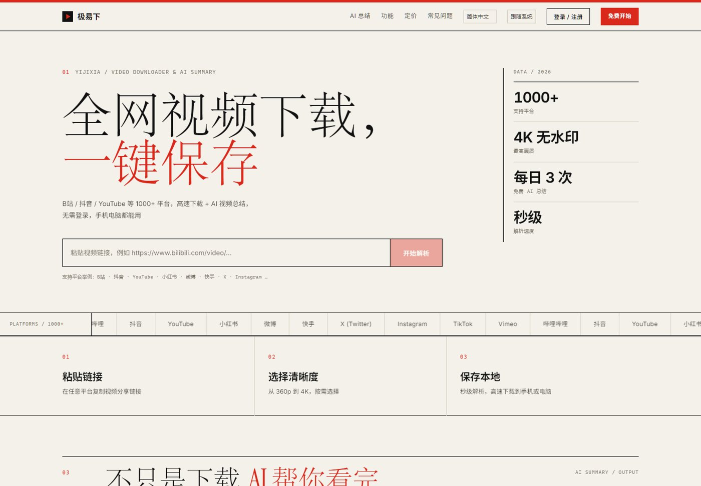
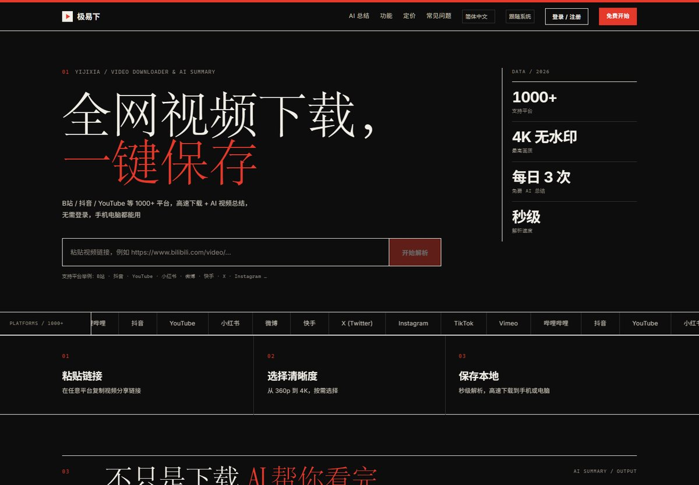
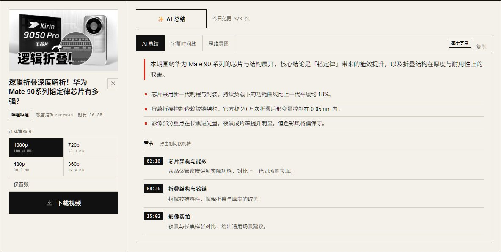

# 极易下 · Yijixia

> 粘贴一个视频链接，下载原片；顺手让 AI 把 1 小时的视频讲成 3 分钟。
> 单服务、单端口、无消息队列：Vue 3 + FastAPI + yt-dlp，SQLite 存账号与订单。
>
> **在线演示**：本项目已部署在自有云服务器，仓库不公开站点地址（部署方式见「部署」一章）；B站下载与 YouTube 受平台 IP 风控限制，见下方「平台支持现状」
> 仓库不包含 `backend/.env`、`backend/static`、`backend/data`、`backend/downloads`，需按下方步骤自行生成。



<details>
<summary>深色版 / 工作台 / 手机端截图</summary>






</details>

## 目录

- [功能](#功能) · [平台支持](#平台支持现状) · [技术栈](#技术栈) · [架构](#架构)
- [快速开始](#快速开始) · [环境变量](#环境变量) · [部署](#部署) · [API](#主要-api)
- [设计系统](#设计系统) · [已知限制](#已知限制) · [文档索引](#文档索引)

## 功能

**下载**

- 粘贴链接即可解析：支持 `B站 / 抖音 / YouTube / 小红书 / 微博 / 快手 / X / Instagram / TikTok` 等 1000+ 平台（yt-dlp 引擎）
- 兼容 App 分享口令文本、短链（`v.douyin.com`、`b23.tv`）
- 多清晰度选择（360p ~ 4K）、仅音频提取（m4a）、下载进度实时显示
- 抖音走自研免 Cookie 通道：服务端自铸访客 `ttwid`，无用户登录、无水印
- 文件 30 分钟自动清理，不落长期存储

**AI 视频总结**

- 解析后一键生成：一句话概述、核心要点、带真实时间戳的章节大纲、思维导图
- 章节时间取自字幕真实时间，可点击跳转到视频对应位置（B站 / YouTube）
- 有字幕优先用字幕；无字幕降级为「标题 + 简介」总结，并在 UI 上如实标注依据
- SSE 流式输出，断连/刷新不丢结果；长视频自动走 map-reduce 分块摘要（实测 262 分钟视频全片覆盖）
- 字幕时间线支持导出 SRT / TXT；思维导图支持全屏查看与 PNG / SVG 导出
- 免费额度：每 IP 每日 3 次（`AI_DAILY_LIMIT` 可调），会员不限次

**账号与会员**

- 邮箱密码注册/登录：scrypt 加盐哈希、HttpOnly Cookie 会话（30 天）、SQLite 持久化
- Stripe Checkout 支付（一次性购买，CNY）：月卡 +30 天 / 年卡 +365 天，从现有到期时间叠加
- 三层幂等防重：Stripe `idempotency_key` / webhook 事件去重表 / 订单原子状态机
- 未配置 Stripe 密钥时自动回退 **Mock 收银台**，本地可跑通完整购买链路
- 权益门禁在服务端强制：非会员 1080p 上限、AI 总结每日限额

**站点**

- 6 语言：简体中文 / English / 日本語 / 한국어 / Español / Français（零依赖自研 i18n，浏览器语言自动检测）
- 三态主题：跟随系统 / 浅色 / 深色（瑞士风格黑纸版）
- 响应式布局，手机浏览器可完成完整流程
- SEO / GEO：后端运行时注入 meta、canonical、OG、JSON-LD，提供 `robots.txt`、`sitemap.xml`、`llms.txt`
- 瑞士国际主义视觉：12 栏网格、细线分隔、Instrument Serif + Inter（自托管，零外链字体）、克制的滚动动效

## 平台支持现状

| 平台 | 本地 / 家宽 | 云服务器（香港） | 说明 |
|---|:---:|:---:|---|
| 抖音 | ✅ | ✅ | 自研通道，免 Cookie、无水印 |
| B站（下载） | ✅ | ❌ `412` | 云 IP 对未签名内容请求返回 412；绕行方案见 `docs/09`（已设计、未实施） |
| B站（AI 总结） | ✅ | ✅ | 走独立 `dm/view` 字幕通道，不经过 yt-dlp |
| YouTube | ✅（需 node） | ⚠️ `bot check` | 数据中心 IP 被登录墙拦截；本地/住宅网络正常，PO Token 无法绕过 |
| 其它 yt-dlp 平台 | ✅ | 视平台而定 | 云 IP 信誉普遍弱于家宽 |

> 结论：**香港等海外 VPS 上，抖音与 B站 AI 总结可用；B站下载与 YouTube 受 IP 风控限制**。
> 大陆 VPS 不受 B站 412 影响，但直连不了 YouTube。这是平台侧限制，不是代码缺陷；详细实测与恢复路径见 `docs/08`。

## 技术栈

| 层 | 选型 | 说明 |
|---|---|---|
| 前端 | Vue 3.5 + Vite 8（rolldown） | 构建产物输出到 `backend/static`，由后端托管；零 UI 框架 |
| 后端 | Python 3.10+ / FastAPI + Uvicorn | yt-dlp 库直调（非命令行），可拿进度回调与结构化异常 |
| 下载引擎 | yt-dlp + ffmpeg | yt-dlp 负责平台适配；ffmpeg 合并 DASH 音视频 / 提取音频 |
| AI | DeepSeek / 智谱 GLM（OpenAI 兼容） | 流式输出；Provider 抽象可替换 |
| 存储 | SQLite（标准库）+ 内存任务表 | 账号/会话/订单落库；下载与总结任务 30 分钟 TTL |
| 支付 | Stripe Checkout | 无密钥自动回退 Mock |
| 字体 | Instrument Serif + Inter | 仅 latin 子集，自托管 91KB |

## 架构

```
┌──────────────┐   /api/*    ┌──────────────────────────┐    ┌──────────────────┐
│  Vue 3 SPA   │────────────▶│  FastAPI（单进程 :8000）  │───▶│ yt-dlp           │
│  构建产物     │◀────────────│                          │    │ B站/YouTube/…    │
│  由后端托管   │   SSE/轮询   │  ├─ analyze / download   │    ├──────────────────┤
└──────────────┘             │  ├─ summary（SSE）        │───▶│ 抖音自研通道      │
                             │  ├─ auth / pay           │    ├──────────────────┤
                             │  ├─ seo 注入 / sitemap    │───▶│ LLM（流式）       │
                             │  └─ 静态托管 + SPA 兜底    │    ├──────────────────┤
                             └──────────┬───────────────┘───▶│ ffmpeg（合并）    │
                                        │                    └──────────────────┘
                                  SQLite（users/sessions/orders/webhook_events）
```

设计要点：

- **单服务单端口**：前端构建产物由 FastAPI 托管，部署只需一个 Python 进程
- **任务内存化**：下载/解析/总结任务存进程内存，30 分钟 TTL；不引入 Redis / 队列
- **单 worker 约束**：内存任务表决定了不能用多进程/多 worker 启动（见部署说明）
- **平台分流**：抖音 → 自研通道；其余 → yt-dlp；B站 AI 总结 → 独立 `dm/view` 通道

## 快速开始

**前置**：Python 3.10+、ffmpeg（建议安装，否则 DASH 高清只能拿到无声视频）、Node 20.19+（仅前端开发/构建需要）

```bash
# 1) 后端依赖 + 环境变量
cd backend
pip install -r requirements.txt
cp .env.example .env          # 至少填写 LLM_API_KEY；不填则 AI 总结不可用，下载不受影响

# 2) 启动（默认 8000 端口，支持 PORT 环境变量）
python run.py
```

```bash
# 3) 前端开发模式（另开终端；/api 已代理到 8000）
cd frontend
npm install
npm run dev                   # http://127.0.0.1:5173

# 4) 发布构建（产物写入 backend/static，由 8000 端口直接托管）
npm run build
```

打开 <http://127.0.0.1:8000> 即可使用。

> **ffmpeg 检查**：`ffmpeg -version` 有输出即可。缺失时下载功能会退化为渐进式格式（通常只有低清）。
> **代理说明**：国内平台（B站/抖音）强制直连；YouTube 走 `backend/proxy.txt` 或系统代理。

## 环境变量

复制 `backend/.env.example` 为 `backend/.env`（已被 `.gitignore` 忽略，不会提交）：

| 变量 | 必填 | 说明 |
|---|:---:|---|
| `LLM_API_KEY` | 是（AI 总结） | DeepSeek / 智谱 API Key；留空则总结接口提示"功能开通中" |
| `LLM_BASE_URL` | 否 | 默认 `https://api.deepseek.com`；智谱填 `https://open.bigmodel.cn/api/paas/v4` |
| `LLM_MODEL` | 否 | 默认 `deepseek-flash`；智谱可用 `glm-4-flash` |
| `AI_DAILY_LIMIT` | 否 | 免费 IP 每日总结次数，默认 3 |
| `STRIPE_API_KEY` | 否 | 留空 = Mock 支付；填 `sk_test_/sk_live_` 走真实 Stripe |
| `STRIPE_WEBHOOK_SECRET` | 否 | webhook 验签密钥 `whsec_...` |
| `SITE_BASE_URL` | 否 | 支付回跳基地址，默认 `http://127.0.0.1:8000` |
| `COOKIE_SECURE` | 否 | HTTPS 部署设为 `1` |
| `ALLOWED_ORIGINS` | 否 | 跨域白名单（逗号分隔），默认仅同源 |
| `SITE_URL` | 否 | 站点正式域名，用于 canonical / sitemap / OG；不填则按请求域名动态推导 |
| `LLM_PROVIDER=mock` | 否 | 仅前端联调用，返回固定数据，上线前必须移除 |

## 目录结构

```
video-downloader/
├── backend/
│   ├── app/
│   │   ├── main.py          # 路由、静态托管、SPA/SEO 兜底、定时清理
│   │   ├── downloader.py    # 解析/下载调度、平台分流、任务表、清晰度门禁
│   │   ├── douyin.py        # 抖音免 Cookie 通道（ttwid + 分享页）
│   │   ├── summarizer.py    # AI 总结：字幕、分块摘要、LLM Provider、SSE 缓冲
│   │   ├── auth.py          # 注册/登录（scrypt）、Cookie 会话、会员判定
│   │   ├── db.py            # SQLite：users / sessions / orders / webhook_events
│   │   ├── payments.py      # 支付抽象：StripeProvider + MockProvider、套餐定义
│   │   ├── seo.py           # 运行时 SEO 注入 + robots/sitemap/llms
│   │   └── envutil.py       # .env 加载（后端统一入口）
│   ├── static/              # 前端构建产物（gitignore）
│   ├── data/                # SQLite 数据库（gitignore，自动创建）
│   ├── downloads/           # 临时下载文件（gitignore，30 分钟清理）
│   ├── cookies/cookies.txt  # 可选：平台 Cookie（gitignore；YouTube 年龄墙用）
│   ├── proxy.txt            # 可选：出站代理（gitignore，每行一个）
│   ├── run.py               # 启动入口（host 0.0.0.0，读 PORT）
│   └── requirements.txt
├── frontend/
│   ├── src/
│   │   ├── App.vue          # 单页应用主体（模板 + 逻辑 + 样式）
│   │   ├── components/MindMap.vue
│   │   ├── i18n.js          # 零依赖 6 语言字典
│   │   ├── theme.js         # 三态主题
│   │   ├── currency.js      # 参考价换算
│   │   └── style.css        # 设计令牌 + 字体 + 动效基础
│   ├── public/fonts/        # 自托管 woff2（Inter / Instrument Serif）
│   └── vite.config.js       # outDir=../backend/static，/api 代理 8000
├── docs/                    # 需求、方案、模块设计与运维文档（见文末索引）
└── README.md
```

## 部署

推荐形态：**一台 VPS + 宝塔面板 + Nginx 反代 + HTTPS**（本项目线上即此形态，香港轻量服务器）。
完整步骤（含防火墙、备案、证书、反代参数）见 **[docs/08-宝塔部署指南.md](docs/08-宝塔部署指南.md)**。

最小步骤：

1. `npm run build` 生成 `backend/static`，把 `backend/`（含 `.env`）上传到服务器
2. 宝塔「Python 项目」启动 `python run.py`，端口 8000，**必须单进程**
3. Nginx 反代 `http://127.0.0.1:8000`，并加两行（AI 总结流式输出必需）：

```nginx
proxy_buffering off;
proxy_read_timeout 1200s;
proxy_send_timeout 1200s;
```

4. HTTPS 证书 + `backend/.env` 设置 `SITE_URL=https://你的域名`、`COOKIE_SECURE=1`
5. Stripe 正式收款需在 Dashboard 配置公网 webhook：`https://你的域名/api/pay/stripe/webhook`

> **不要用多 worker 启动**（`uvicorn --workers N` / gunicorn 多进程）：任务表、SSE 缓冲都在进程内存，
> 多进程会导致"提交了任务查不到进度"。

## 主要 API

| 方法 | 路径 | 说明 |
|---|---|---|
| POST | `/api/analyze` | 提交解析，返回 `analyze_id`（兼容分享口令文本） |
| GET | `/api/analyze/{id}` | 轮询解析结果：`running / done(info) / error(detail)` |
| POST | `/api/download` | 创建下载任务 `{url, format_id, mode}`；非会员服务端强制 1080p 上限 |
| GET | `/api/task/{id}` | 下载进度：`downloading / processing / done / error` |
| GET | `/api/file/{id}` | 下载成品（30 分钟有效） |
| POST | `/api/summary` | 创建 AI 总结任务，返回 `task_id` |
| GET | `/api/summary/quota` | 当前 IP 的免费额度 |
| GET | `/api/summary/{id}/stream` | SSE：`status → meta → delta* → done/error` |
| GET | `/api/summary/{id}` | 总结轮询兜底 |
| POST | `/api/auth/register` `/login` `/logout` | 邮箱密码认证，HttpOnly Cookie |
| GET | `/api/auth/me` | 当前用户与会员状态（恒 200） |
| GET | `/api/plans` | 套餐列表 |
| POST | `/api/pay/order` | 创建订单（需登录） |
| POST | `/api/pay/stripe/webhook` | Stripe 回调（原始 body 验签） |
| POST | `/api/pay/mock/confirm` | 仅 Mock 渠道可用；配置 Stripe 后返回 403 |
| GET | `/robots.txt` `/sitemap.xml` `/llms.txt` | 运行时生成的 SEO / GEO 文件 |

## 设计系统

2026-10-23 起全站改为**瑞士国际主义（Swiss Style）**：纸白 `#F4F1EA`、墨黑 `#111111`、强调红 `#DA291C`；12 栏网格、1px 细线、左对齐、零圆角/阴影/渐变；深色模式为黑纸版。

- **字体**：大标题 Instrument Serif 400（中文回退宋体），正文 Inter；均为 latin 子集自托管（共 91KB），不依赖 Google Fonts
- **动效**：`v-reveal` 滚动入场、首屏分级淡入、导航滚动进度、平台跑马灯、按钮/卡片微交互；全部尊重 `prefers-reduced-motion`
- **主题**：三态（跟随系统 / 浅 / 深），`theme.js` + CSS 变量，`index.html` 防闪烁
- **i18n**：`i18n.js` 扁平字典，6 语言，零依赖

细节与设计决策见 [docs/11-前端瑞士风格改版.md](docs/11-前端瑞士风格改版.md)。

## 已知限制

- **云服务器 IP 风控**：B站下载返回 `412`、YouTube 返回 bot check（详见"平台支持现状"与 docs/08/09）
- **B站未登录最高 1080p**：4K / 1080P60 需大会员账号（平台限制）
- 抖音图集/图文不支持（明确报错）
- AI 总结依赖字幕；无字幕平台只能做标题/简介级总结
- YouTube 年龄限制视频需要站长配置 `cookies/cookies.txt`（登录态），且受 IP 限制
- 任务与文件 30 分钟过期；服务重启会丢失进行中的任务
- 会员文案中的「批量下载队列 / 优先下载通道」尚未实现（PLANS 文案占位）
- **不要以 Mock 支付状态公开上线**：未配置 `STRIPE_API_KEY` 时 `POST /api/pay/mock/confirm` 可用，
  任何人都能免费开通会员。对外运营前必须配置 Stripe 或关闭购买入口
- Stripe 真实支付尚未完成 Test/Live 联调（代码路径完整，配置后需按 docs/06 §4 验收）

## 文档索引

| 文档 | 内容 |
|---|---|
| [01-需求分析](docs/01-需求分析.md) | 背景、用户场景、需求优先级与现状对照 |
| [02-方案设计](docs/02-方案设计.md) | 架构、选型、核心流程、模块边界 |
| [03-AI视频总结功能方案](docs/03-AI视频总结功能方案.md) | 字幕通道、分块摘要、SSE、LLM 接入与限流 |
| [04-功能扩展与前端改版](docs/04-功能扩展与前端改版.md) | 导图/字幕下载、总结调优、i18n 与线上问题（历史） |
| [05-SEO优化与运营清单](docs/05-SEO优化与运营清单.md) | 运行时 SEO 注入、GEO、站长提交清单 |
| [06-支付与会员系统](docs/06-支付与会员系统.md) | 登录、Stripe、幂等三层、权益门禁、运维手册 |
| [07-落地页改版与会员体验](docs/07-落地页改版与会员体验.md) | Teal 版落地页决策（**历史归档**，现状见 11） |
| [08-宝塔部署指南](docs/08-宝塔部署指南.md) | 从零部署、域名/HTTPS、IP 风控实测、YouTube 专项 |
| [09-B站直连通道方案](docs/09-B站直连通道方案.md) | WBI/指纹探测、全链路验证、开工清单（**已搁置**） |
| [10-简历项目描述](docs/10-简历项目描述.md) | 项目经历写法与面试追问准备 |
| [11-前端瑞士风格改版](docs/11-前端瑞士风格改版.md) | 设计令牌、字体、动效、组件规范与验证 |

## 免责声明

本项目仅用于技术学习与研究。所有视频内容版权归原平台及作者所有，请勿用于商业传播；
下载与总结行为应遵守各平台用户协议及当地法律法规。使用者自行承担相关责任。

## License

仓库暂未声明开源许可证（All rights reserved）。如需开源分发，建议补充 MIT 或 Apache-2.0 LICENSE 文件。

## 致谢

- [yt-dlp](https://github.com/yt-dlp/yt-dlp)：1000+ 平台的解析能力
- [FastAPI](https://fastapi.tiangolo.com/) / [Vue](https://vuejs.org/) / [Vite](https://vite.dev/)
- [Inter](https://rsms.me/inter/) 与 [Instrument Serif](https://fonts.google.com/specimen/Instrument+Serif)（SIL OFL）
